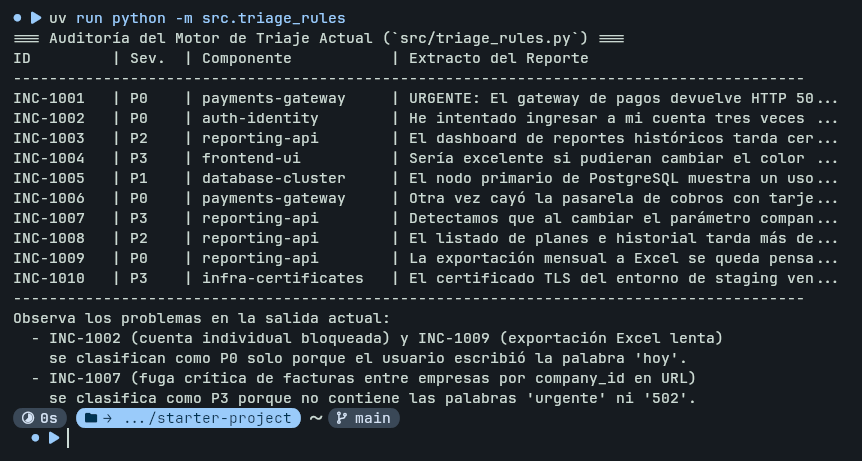
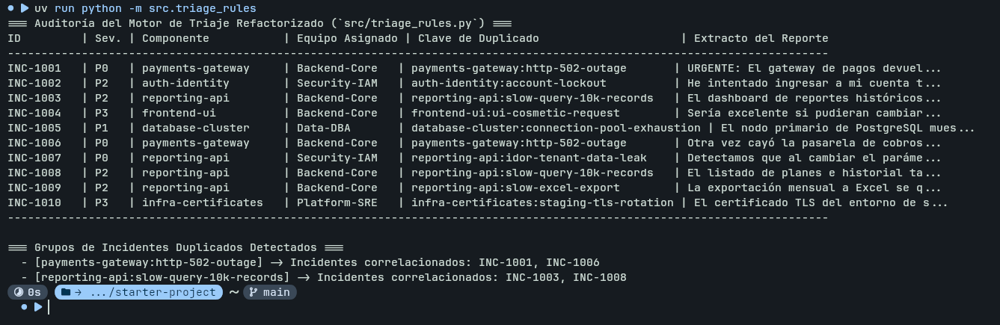
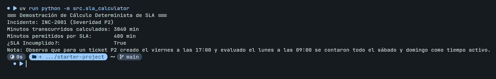
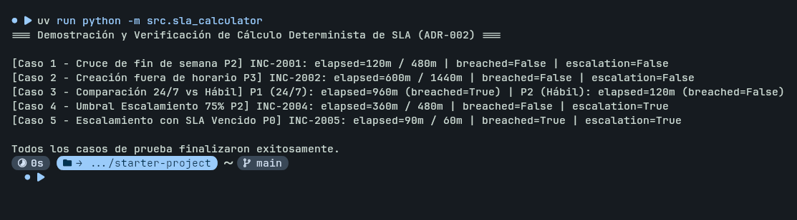

# Bitácora de Ingeniería de Prompts y Contexto — Semana 1 (`CONTEXT_LOG.md`)

**Estudiante**: `Juan Felipe Alonso Robayo`

**Fecha**: `2024-06-16`

**Modelos / Asistentes Utilizados**:

- `Gemini Flash-Lite - Nivel de pensamiento bajo`
- `Gemini hydrogen - Nivel de pensamiento bajo`
- `Gemini Argon - Nivel de pensamiento bajo`

**Enlace al Repositorio**: [`JuanFelipeAlonsoRobayo/starter-project`](https://github.com/JuanFelipeAlonsoRobayo/starter-project.git)

---

## 1. De Prompts Pobres a Técnicas Clásicas de *Prompt Engineering* (Reto 1: `src/triage_rules.py`)

### 1.1 Diagnóstico de un Prompt Pobre y Ambiguo
Analiza el siguiente prompt deficiente para el Reto 1:
> *"El archivo `triage_rules.py` funciona mal con algunos tickets del JSON. Agrégale el equipo recomendado y una clave para duplicados, y no pongas P0 cuando no sea urgente."*

Documenta al menos **3 modos de fallo o ambigüedades** de este prompt (p. ej., ausencia de contexto de dominio, restricciones negativas difusas, falta de enumeración de equipos válidos o ausencia de ejemplos canónicos):

1. **Restricción negativa difusa**: *"Urgente"* es un criterio subjetivo y las instrucciones basadas solo en qué no hacer suelen fallar.
2. **Falta de enumeración de equipos válidos**: Solicitar un *"equipo recomendado"* sin enumerar la lista cerrada de equipos existentes ni sus reglas de asignación puede hacer que el modelo invente nombres arbitrarios.
3. **Esquema de entrada, salida y lógica indefinidos**: Mencionar que *"funciona mal con algunos tickets del JSON"* y pedir una *"clave para duplicados"* sin dar ejemplos de los casos que fallan ni especificar el algoritmo de deduplicación obliga al modelo a adivinar qué corregir y cómo estructurar los nuevos atributos en el código.

### 1.2 Uso de *Self-Consistency*, *Chain-of-Thought* y *Few-Shot Prompting*
- **¿Cómo utilizaste *Chain-of-Thought* (`<analysis>`) y *Self-Consistency* (múltiples consultas independientes) para definir las reglas de clasificación de los casos ambiguos (`INC-1002`, `INC-1007`, `INC-1009`) y la agrupación de duplicados (`INC-1001`/`INC-1006` e `INC-1003`/`INC-1008`)?**

  - **Consulta 1 — Gemini Flash-Lite (Nivel de pensamiento bajo)**: [Enlace a la conversación](https://share.gemini.google/spppH6jRBoat)
  - **Consulta 2 — Gemini Hydrogen (Nivel de pensamiento bajo)**: [Enlace a la conversación](https://gemini.google.com/share/2cb4117663a6)
  - **Consulta 3 — Gemini Argon (Nivel de pensamiento bajo)**: [Enlace a la conversación](https://share.gemini.google/Zk34K9CiVmgc)

  > **Conclusión**: En las tres consultas independientes se obtuvo **consenso unánime en la severidad** de los casos ambiguos:
  > - `INC-1002` como **P2**
  > - `INC-1007` como **P0**
  > - `INC-1009` como **P2**
  >
  > Además, comparar las tres salidas permitió detectar que, aunque la severidad fue 100% consistente, el nombre del componente varió cuando no estaba predefinido en `<examples>` (`reports-pdf` vs. `billing-reports-security` en `INC-1007`, y `export-service` vs. `reporting-export` en `INC-1009`), demostrando la necesidad de fijar un catálogo cerrado de equipos/componentes y claves canónicas (`dedup_key`) para agrupar sin ambigüedad tickets duplicados.

- **Copia el prompt mejorado que empleaste aplicando las técnicas clásicas (`<role>`, `<domain_rules>` con justificación del *porqué*, `<examples>` *Few-Shot* y `<task>`)**:

```xml
<!-- Cabe mencionar que no se pega el contenido de "sample_incidents.json" sino que se adjunta al chat -->

<role>
  Actúa como Ingeniero Principal de Confiabilidad (SRE) y Seguridad en IncidentOps.
</role>

<domain_rules>
  Debemos clasificar reportes de incidentes en cuatro niveles de severidad:
  - P0 (SLA 60 min, guardia 24/7): Indisponibilidad global de un servicio crítico (ej. pagos HTTP 502) o brecha activa de seguridad / fuga de datos entre organizaciones (multi-tenant).
  - P1 (SLA 240 min, guardia 24/7): Degradación severa de infraestructura compartida con riesgo inminente de caída (ej. pool de conexiones de base de datos >90%).
  - P2 (SLA 480 min, horario hábil L-V 08:00-18:00): Degradación moderada de rendimiento sin caída del servicio (ej. reportes lentos >3s) o bloqueo operativo que afecta únicamente a un usuario individual.
  - P3 (SLA 1440 min, horario hábil): Solicitudes cosméticas de UI o tareas preventivas de mantenimiento en entornos no productivos (staging).

  Equipos válidos (`recommended_team`): `Backend-Core`, `Platform-SRE`, `Data-DBA`, `Security-IAM`.
  Componentes válidos (`component`): `payments-gateway`, `auth-identity`, `database-cluster`, `infra-certificates`, `frontend-ui`, `reporting-api`.
  Clave de duplicados (`duplicate_group_key`): formato normalizado `<component>:<symptom_category>` para agrupar reportes distintos que comparten la misma causa raíz.

  Importante (Por qué): La prioridad depende del impacto real sobre la disponibilidad, la integridad de datos multi-tenant y el radio de afectación, nunca de palabras emocionales o de prisa subjetiva del usuario como "urgente" u "hoy".
</domain_rules>

<examples>
  <example>
    Input: "El botón de exportar tiene un gris muy claro, sería mejor azul."
    <analysis>
      1. Radio de afectación: Visual/cosmético, cero impacto funcional.
      2. Riesgo de seguridad o caída: Ninguno.
    </analysis>
    <output>severity=P3 | component=frontend-ui | recommended_team=Backend-Core | duplicate_group_key=frontend-ui:cosmetic-ui</output>
  </example>

  <example>
    Input: "No puedo entrar a mi correo corporativo desde mi celular, urge resolver hoy."
    <analysis>
      1. Radio de afectación: Un único usuario (cuenta individual), el servicio global de autenticación sigue operativo.
      2. Nota léxica: Incluye la palabra "hoy", pero por regla de dominio la prisa individual no eleva un ticket a guardia 24/7 (P0).
    </analysis>
    <output>severity=P2 | component=auth-identity | recommended_team=Security-IAM | duplicate_group_key=auth-identity:account-access</output>
  </example>
</examples>

<incidents>
  - INC-1001: "URGENTE: El gateway de pagos devuelve HTTP 502 Bad Gateway en todas las transacciones con tarjeta de crédito desde hace 12 minutos. Ningún comercio puede cobrar."
  - INC-1002: "He intentado ingresar a mi cuenta tres veces y ahora aparece bloqueada. Necesito acceder hoy mismo porque debo enviar el informe de cierre a la junta directiva."
  - INC-1003: "El dashboard de reportes históricos tarda cerca de 4.5 segundos en cargar cuando un cliente tiene más de 10,000 órdenes registradas. No da error, pero la experiencia es muy lenta."
  - INC-1006: "Otra vez cayó la pasarela de cobros con tarjeta, a nuestros clientes les sale error 502 al intentar pagar el carrito de compras."
  - INC-1007: "Detectamos que al cambiar el parámetro company_id en la URL del reporte PDF se pueden visualizar facturas pertenecientes a otra organización."
  - INC-1008: "El listado de planes e historial tarda más de 3 segundos en responder cada vez que abrimos la pestaña de clientes corporativos con más de 10,000 registros."
  - INC-1009: "La exportación mensual a Excel se queda pensando unos 20 segundos pero al final sí descarga el archivo completo. Hoy tenemos cierre contable y nos preocupa que falle más tarde."
</incidents>

<task>
  Para cada incidente en `<incidents>`, razona primero paso a paso dentro de una etiqueta `<analysis>` evaluando el alcance (radio de afectación), el riesgo en seguridad/disponibilidad, las trampas léxicas y si es duplicado de otro ticket (`INC-1001`/`INC-1006` e `INC-1003`/`INC-1008`). Luego emite la clasificación final en `<output>` con `severity`, `component`, `recommended_team` y `duplicate_group_key`.
</task>
```

### 1.3 Refactorización con Rol, Instrucciones Afirmativas, *Few-Shot* y Etiquetas XML
Para este punto, por su complejidad, se decidió emplear el modelo **Gemini Argon (Nivel de pensamiento bajo)**. A continuación comparto el enlace al chat solicitando los cambios en `src/triage_rules.py` y `src/models.py`:

- **Consulta — Gemini Argon (Nivel de pensamiento bajo)**: [Enlace a la conversación](https://share.gemini.google/bbAAXyNxA6Ut)

- **Evidencia de la ejecución de `uv run python -m src.triage_rules`**:
  - **Estado inicial**:

    

  - **Con cambios aplicados**:

    


---

## 2. Flujo Explorar $\rightarrow$ Destilar $\rightarrow$ Ejecutar en Contexto Limpio (Reto 2: Cálculo de SLA en Horario Hábil y ADR-002)

### 2.1 Exploración de Diseño (Sin Generar Código Aún) y Destilación
- **Objetivo explorado**: Diseño del algoritmo de cálculo de SLA en horario hábil (`P2`/`P3`, Lunes–Viernes 08:00–18:00) vs. 24/7 (`P0`/`P1`) y regla de escalamiento preventivo al 75%.
- **Consulta de exploración — Gemini Hydrogen (Nivel de pensamiento bajo)**: [Enlace a la conversación](https://share.gemini.google/Uypw8f7JSYMc)

- **Síntesis de tu exploración de alternativas y resumen destilado (máx. 10 líneas)**:

  > **Opciones descartadas**:
  > - *Cálculo corrido 24/7 para prioridades `P2`/`P3`*: Contabiliza noches y fines de semana, generando falsos incumplimientos fuera de jornada laboral.
  > - *Iteración minuto a minuto $O(M)$*: Ineficiente y lento en tickets de larga duración como los `P3`.
  > - *Librerías externas de calendario*: Innecesarias frente al uso de `datetime` estándar.
  > - *Restricción `and not is_breached` en el escalamiento*: Apagaba erróneamente la alerta de escalamiento justo cuando el SLA ya estaba vencido.
  >
  > **Decisión acordada**:
  > - *Iteración diaria $O(D)$ con intersección de ventanas*: Recorrer día por día entre creación y cierre usando `datetime`, ignorando fines de semana (`weekday() >= 5`) y acotando cada día hábil al rango `[08:00, 18:00]` mediante `max()` y `min()`.
  > - *Escalamiento unificado*: Activar `requires_escalation` cuando el ticket no esté resuelto y `elapsed_minutes >= escalation_limit`, cubriendo tanto el umbral del 75% como los incidentes ya vencidos.

### 2.2 Ejecución con Contexto Curado en Nuevo Chat Limpio (*Context Engineering*)

- **Consulta de ejecución — Gemini Argon (Nivel de pensamiento bajo)**: [Enlace a la conversación](https://share.gemini.google/E6e1pVeeyCSN)

- **Copia el prompt estructurado con etiquetas XML que utilizaste en un nuevo chat limpio para generar el ADR (`docs/adr/002-calculo-sla-horario-habil.md`) y la refactorización de `src/sla_calculator.py`**:


```xml
<!-- Se adjunta también el archivo docs/adr/000-template.md y src/sla_calculator.py-->

<context>
  Necesitamos corregir el cálculo de SLA en `src/sla_calculator.py` y documentar la decisión en un ADR.

  <lsp_context symbol="evaluate_sla_status">
    <!-- 1. Definiciones de Tipos y Políticas (LSP Hover / Type Definition) -->
    # [LSP textDocument/hover type] src/models.py:13
    class SLARule:
        """Define el acuerdo de nivel de servicio (SLA) para un nivel de severidad."""

        severity: SeverityLevel
        max_resolution_minutes: int
        operates_24x7: bool
        escalation_threshold_ratio: float = 0.75

    # [LSP textDocument/hover type] src/models.py:23
    class Incident:
        """Representa un incidente registrado en la plataforma IncidentOps."""

        incident_id: str
        title: str
        component: str
        severity: SeverityLevel
        status: IncidentStatus
        created_at: datetime
        resolved_at: Optional[datetime] = None

    # [LSP textDocument/hover type] src/models.py:36
    class SLAEvaluation:
        """Resultado determinista de la evaluación de SLA de un incidente."""

        incident_id: str
        severity: SeverityLevel
        elapsed_minutes: int
        allowed_minutes: int
        remaining_minutes: int
        is_breached: bool
        requires_escalation: bool

    # [LSP textDocument/hover type] src/models.py:49
    class TriageResult:
        """Resultado estructurado producido por el clasificador de triaje con IA."""

        incident_id: str
        severity: SeverityLevel
        component: str
        recommended_team: RecommendedTeam
        duplicate_group_key: str
        rationale: str
        consistency_ratio: float = 1.0

    # [LSP textDocument/hover symbol] src/sla_calculator.py:17
    SLA_POLICY_TABLE: Dict[SeverityLevel, SLARule] = {
        "P0": SLARule(severity="P0", max_resolution_minutes=60, operates_24x7=True),
        "P1": SLARule(severity="P1", max_resolution_minutes=240, operates_24x7=True),
        "P2": SLARule(severity="P2", max_resolution_minutes=480, operates_24x7=False),
        "P3": SLARule(severity="P3", max_resolution_minutes=1440, operates_24x7=False),
    }

    <!-- 2. Definición Exacta del Símbolo (LSP GoToDefinition) -->
    # [LSP textDocument/definition] src/sla_calculator.py:25
    def get_sla_rule_for_severity(severity: SeverityLevel) -> SLARule:
        """Obtiene la regla de SLA aplicable a una severidad validada contra la tabla."""
        if severity not in SLA_POLICY_TABLE:
            raise ValueError(f"Severidad no válida: {severity}")
        return SLA_POLICY_TABLE[severity]

    # [LSP textDocument/definition] src/sla_calculator.py:32
    def evaluate_sla_status(incident: Incident, reference_time: datetime) -> SLAEvaluation:
        """Evalúa si un incidente ha incumplido su SLA o requiere escalamiento preventivo."""
        rule = get_sla_rule_for_severity(incident.severity)
        end_time = incident.resolved_at or reference_time

        if end_time < incident.created_at:
            raise ValueError("El tiempo de referencia no puede ser anterior a la creación.")

        # TODO(week-1-taller): Cuando rule.operates_24x7 es False (P2 y P3), solo deben
        # contabilizarse los minutos dentro del horario hábil (Lunes-Viernes 08:00-18:00).
        delta_seconds = (end_time - incident.created_at).total_seconds()
        elapsed_minutes = int(delta_seconds // 60)

        remaining_minutes = rule.max_resolution_minutes - elapsed_minutes
        is_breached = elapsed_minutes > rule.max_resolution_minutes

        escalation_limit = int(rule.max_resolution_minutes * rule.escalation_threshold_ratio)
        requires_escalation = (
            incident.status != "RESOLVED"
            and not is_breached
            and elapsed_minutes >= escalation_limit
        )

        return SLAEvaluation(
            incident_id=incident.incident_id,
            severity=incident.severity,
            elapsed_minutes=elapsed_minutes,
            allowed_minutes=rule.max_resolution_minutes,
            remaining_minutes=remaining_minutes,
            is_breached=is_breached,
            requires_escalation=requires_escalation,
        )

    <!-- 3. Referencias de Invocación en el Proyecto (LSP FindReferences) -->
    # [LSP textDocument/references] src/incident_repository.py:146
      L145:             )
      L146:             sla_eval = evaluate_sla_status(incident, reference_time=reference_time)
      L147:             results.append(

    # [LSP textDocument/references] src/sla_calculator.py:87
      L86:     monday_morning = datetime(2026, 11, 9, 9, 0, 0)
      L87:     evaluation = evaluate_sla_status(sample_incident, reference_time=monday_morning)
  </lsp_context>
</context>

<decision_summary>
  Opciones descartadas:
  - Cálculo corrido 24/7 para prioridades P2/P3: Contabiliza noches y fines de semana, generando falsos incumplimientos fuera de jornada laboral.
  - Iteración minuto a minuto O(M): Ineficiente y lento en tickets de larga duración como los P3.
  - Librerías externas de calendario: Innecesarias frente al uso de `datetime` estándar.
  - Restricción `and not is_breached` en el escalamiento: Apagaba erróneamente la alerta de escalamiento justo cuando el SLA ya estaba vencido.

  Decisión acordada:
  - Iteración diaria O(D) con intersección de ventanas: Recorrer día por día entre creación y cierre usando `datetime`, ignorando fines de semana (`weekday() >= 5`) y acotando cada día hábil al rango [08:00, 18:00] mediante `max()` y `min()`.
  - Escalamiento unificado: Activar `requires_escalation` cuando el ticket no esté resuelto y `elapsed_minutes >= escalation_limit`, cubriendo tanto el umbral del 75% como los incidentes ya vencidos.
</decision_summary>

<constraints>
  - Solo usar la librería estándar `datetime` de Python (sin librerías externas), manteniendo una lógica simple día por día O(D).
  - Para P0 y P1 (`operates_24x7=True`), mantener el cálculo continuo 24/7.
  - Para P2 y P3 (`operates_24x7=False`), contar únicamente los minutos entre las 08:00 y las 18:00 de lunes a viernes (máximo 600 min por día hábil).
  - `requires_escalation` debe ser `True` cuando el incidente siga abierto (`status != "RESOLVED"`) y haya alcanzado al menos el 75% del SLA o ya esté vencido (`is_breached=True`).
</constraints>

<task>
  1. Siguiendo la estructura de `docs/adr/000-template.md`, redacta el documento `docs/adr/002-calculo-sla-horario-habil.md` incluyendo un diagrama Mermaid (`flowchart TD`) que muestre el flujo del cálculo y la regla de escalamiento.
  2. Refactoriza `src/sla_calculator.py` aplicando el diseño acordado y actualiza su bloque `__main__` con 5 casos de prueba (incluyendo creación fuera de horario, cruces de fin de semana y comparación 24/7 vs. horario hábil).
</task>
```

### 2.3 Implementación Local y Verificación Determinista en Terminal

- **Documento de arquitectura generado**: [002-calculo-sla-horario-habil.md](./docs/adr/002-calculo-sla-horario-habil.md)

- **Evidencia de la ejecución de `uv run python -m src.sla_calculator`**:

  - **Estado inicial (sin modificar)**:

    

  - **Con cambios aplicados (horario hábil y 5 casos borde)**:

    

---

## 3. Economía de Tokens y Curaduría de Contexto con `tiktoken` (LSP vs. `grep`/`read` vs. `glob`/`read`)

### 3.1 Medición Empírica en *IncidentOps*

- **1. Salida de `uv run python -m src.context_audit --symbol classify_incident_report` (Reto 1)**:

```text
====================================================================================
 AUDITORÍA DE CONTEXT ENGINEERING: Símbolo objetivo `classify_incident_report`
 Tokenizador activo: tiktoken (o200k_base)
====================================================================================
Estrategia                             | Alcance            | Caracteres | Tokens
------------------------------------------------------------------------------------
1. Fuerza Bruta (glob + read todo)     | 9 archivos         | 46824      | 12084 tokens
2. Búsqueda Textual (grep + read .py)  | 2 archivos .py     | 8154       | 1986 tokens
3. Semántica vía LSP (AST/Symbols)     | Definición+Refs    | 7045       | 1748 tokens
------------------------------------------------------------------------------------
-> Reducción LSP vs. Fuerza Bruta (`glob` + `read`): 85.5% menos tokens
-> Reducción LSP vs. Búsqueda (`grep` + `read` .py): 12.0% menos tokens
```

| Estrategia de Recolección de Contexto (`classify_incident_report`) | Alcance (Archivos / Nodos) | Caracteres Totales | Tokens (`tiktoken o200k_base`) | % de Reducción vs. Fuerza Bruta |
| :--- | :--- | :---: | :---: | :---: |
| **Nivel 1 — Fuerza Bruta (`glob` + `read` todo)** | 9 archivos | 46,824 | 12,084 tokens | 0% (Línea base) |
| **Nivel 2 — Búsqueda Textual (`grep` + `read` `.py`)** | 2 archivos `.py` | 8,154 | 1,986 tokens | 83.6% |
| **Nivel 3 — Semántica vía LSP (`definition` + `references` + `hover`)** | Definición + Tipos + Referencias | 7,045 | 1,748 tokens | **85.5%** (y **12.0%** vs. `grep`) |

- **2. Salida de `uv run python -m src.context_audit --symbol evaluate_sla_status` (Reto 2)**:

```text
====================================================================================
 AUDITORÍA DE CONTEXT ENGINEERING: Símbolo objetivo `evaluate_sla_status`
 Tokenizador activo: tiktoken (o200k_base)
====================================================================================
Estrategia                             | Alcance            | Caracteres | Tokens
------------------------------------------------------------------------------------
1. Fuerza Bruta (glob + read todo)     | 9 archivos         | 46824      | 12084 tokens
2. Búsqueda Textual (grep + read .py)  | 4 archivos .py     | 29196      | 7439 tokens
3. Semántica vía LSP (AST/Symbols)     | Definición+Refs    | 5724       | 1559 tokens
------------------------------------------------------------------------------------
-> Reducción LSP vs. Fuerza Bruta (`glob` + `read`): 87.1% menos tokens
-> Reducción LSP vs. Búsqueda (`grep` + `read` .py): 79.0% menos tokens
```

| Estrategia de Recolección de Contexto (`evaluate_sla_status`) | Alcance (Archivos / Nodos) | Caracteres Totales | Tokens (`tiktoken o200k_base`) | % de Reducción vs. Fuerza Bruta |
| :--- | :--- | :---: | :---: | :---: |
| **Nivel 1 — Fuerza Bruta (`glob` + `read` todo)** | 9 archivos | 46,824 | 12,084 tokens | 0% (Línea base) |
| **Nivel 2 — Búsqueda Textual (`grep` + `read` `.py`)** | 4 archivos `.py` | 29,196 | 7,439 tokens | 38.4% |
| **Nivel 3 — Semántica vía LSP (`definition` + `references` + `hover`)** | Definición + Tipos + Referencias | 5,724 | 1,559 tokens | **87.1%** (y **79.0%** vs. `grep`) |

> **Análisis de ahorro de tokens en los Pasos 1 y 2**:
> - En el **Paso 1 (`classify_incident_report`)**, usar el bloque `<lsp_context>` (Nivel 3: **1,748 tokens**, o **1,069 tokens** antes de refactorizar) frente a pegar todo el repositorio por Fuerza Bruta (Nivel 1: **12,084 tokens**, o **8,216 tokens** antes de refactorizar) ahorró **entre 7,147 y 10,336 tokens por consulta** (**85.5%–87.0% de reducción**).
> - En el **Paso 2 (`evaluate_sla_status`)**, usar `<lsp_context>` (Nivel 3: **1,559 tokens**) ahorró **10,525 tokens por consulta** frente a Fuerza Bruta (**87.1% menos**) y **5,880 tokens** frente a `grep + read` (**79.0% menos**), manteniendo la ventana de contexto libre de ruido en ambos chats (exploración y ejecución).

### 3.2 Comparación de Formatos de Serialización (`--compare-formats`)

- **1. Salida de `uv run python -m src.context_audit --compare-formats`**:

```text
==========================================================================
 IMPACTO DEL FORMATO DE DATOS EN LA VENTANA DE CONTEXTO (10 Incidentes)
 Tokenizador activo: tiktoken (o200k_base)
==========================================================================
Formato de Serialización       | Caracteres   | Tokens
--------------------------------------------------------------------------
JSON Indentado (indent=2)      | 2942         | 878 tokens
JSON Compacto (minified)       | 2641         | 728 tokens
YAML Equivalente               | 2579         | 755 tokens
CSV Delimitado por '|'         | 2171         | 617 tokens
--------------------------------------------------------------------------
```

| Formato de Serialización | Caracteres Totales | Tokens (`tiktoken o200k_base`) | % de Reducción vs. JSON Indentado |
| :--- | :---: | :---: | :---: |
| **JSON Indentado (`indent=2`)** | 2,942 | 878 tokens | 0% (Línea base) |
| **JSON Compacto (`minified`)** | 2,641 | 728 tokens | 17.1% |
| **YAML Equivalente** | 2,579 | 755 tokens | 14.0% |
| **CSV Delimitado por `\|`** | 2,171 | **617 tokens** | **29.7%** |

> **Elección de formato**: Para inyectar datos tabulares homogéneos o lotes largos de logs en la ventana de contexto, elegiría **CSV delimitado por `|`** (617 tokens vs. 878 tokens en JSON indentado, ahorrando un **29.7%**), porque define los nombres de los campos una única vez en la cabecera y evita repetir llaves, comillas y espacios de indentación en cada registro. Si la estructura tuviera anidamiento, optaría por **JSON compacto** (17.1% de ahorro).

---

## 4. Comparación Crítica entre Tipos de Modelos y Matriz de Decisión Arquitectónica

### 4.1 Comparación Crítica entre Tipos de Modelos (Modelo Rápido/Estándar vs. Modelo de Razonamiento)
Durante el desarrollo de los retos se contrastó el comportamiento de un modelo rápido/estándar frente a modelos de mayor capacidad y razonamiento:

- **Modelo Rápido / Estándar (`Gemini Flash-Lite`)**:
  - **Fortalezas**: Respuesta casi instantánea y menor costo por token. Cuando las reglas de negocio (`<domain_rules>`) y el formato de salida (`<examples>`) están bien acotados, clasifica sin problema la severidad (`P0`–`P3`) e identifica trampas léxicas simples (*"hoy mismo"*, *"cierre contable"*).
  - **Limitaciones**: Cuando un campo no tiene una lista cerrada de valores permitidos en los ejemplos, tiende a improvisar identificadores distintos (como `reports-pdf` o `export-service`), y es más propenso a omitir casos borde si se le pide diseñar algoritmos con múltiples condiciones de frontera.
- **Modelo de Razonamiento / Mayor Capacidad (`Gemini Hydrogen` y `Gemini Argon`)**:
  - **Fortalezas**: Mantienen la coherencia entre múltiples restricciones simultáneas. Fueron clave en el **Paso 1.3** (refactorizar coordinadamente `src/models.py` y `src/triage_rules.py` respetando firmas de tipos y claves de duplicados) y en el **Paso 2** (identificar casos borde de tickets creados en viernes fuera de horario o en sábado, diseñar la intersección de intervalos diarios $O(D)$, corregir la condición `and not is_breached` y redactar el `ADR-002` con diagrama Mermaid).
  - **Conclusión práctica**: El modelo rápido es ideal para tareas acotadas de clasificación y validación rápida (*Self-Consistency*), mientras que el modelo de razonamiento es indispensable en las fases de exploración de diseño arquitectónico, detección de casos borde y refactorización de código con múltiples invariantes.

### 4.2 Matriz de Decisión Arquitectónica (Código Determinista vs. ML Clásico vs. GenAI)
Para la evolución de *IncidentOps*, se define qué paradigma emplear según la naturaleza técnica de cada requerimiento:

| Caso de Uso en *IncidentOps* | Paradigma Elegido | Justificación de Ingeniería (Determinismo, Costo, Latencia y Riesgo) |
| :--- | :--- | :--- |
| **1. Cálculo de minutos hábiles de SLA (`08:00–18:00` L–V) y alerta de escalamiento al 75%** | **Código Determinista** (`src/sla_calculator.py`) | Es un problema aritmético y de calendario con reglas exactas. Debe ejecutarse en microsegundos, con costo cero por invocación, 100% de repetibilidad y cero riesgo de alucinación. |
| **2. Clasificación y enrutamiento de incidentes con patrones conocidos y reglas fijas** | **Código Determinista** (`src/triage_rules.py`) | Cuando los patrones y síntomas están bien definidos, las reglas deterministas garantizan latencia mínima, trazabilidad total y cero costo de API externa en tiempo de ejecución. |
| **3. Detección de anomalías en millones de métricas numéricas de infraestructura (CPU, RAM, latencia DB) por minuto** | **ML Clásico** (Estadística / *Isolation Forest* / Series de tiempo) | El volumen de datos numéricos de alta frecuencia hace inviable usar un LLM por latencia y costo de tokens; los modelos estadísticos o de ML clásico procesan miles de puntos por segundo con bajo costo computacional. |
| **4. Exploración de casos borde, redacción de ADRs (`ADR-002`) y refactorización asistida del código base** | **GenAI como Asistente en Desarrollo** (*AI for Software Engineering*) | Opera fuera del camino crítico de producción. Permite explorar alternativas, destilar decisiones arquitectónicas y acelerar la escritura de código que luego se valida determinísticamente en terminal (`uv run`). |
| **5. Triaje de reportes en lenguaje natural libre cuando aparecen síntomas nuevos no cubiertos por reglas estáticas** | **GenAI / LLM en Tiempo de Ejecución** (con salida estructurada y *fallback*) | Cuando el texto del usuario es ambiguo o inédito, un LLM con *Few-Shot* y esquema tipado (`TriageResult`) comprende el contexto semántico mejor que un `if/elif`, usándose como respaldo controlado. |
