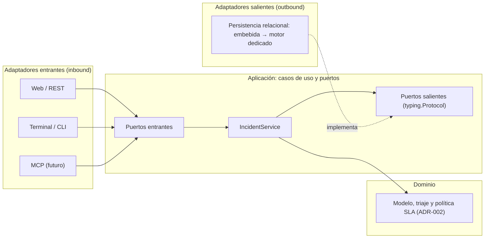

# ADR-003: Adopción de Arquitectura Hexagonal (Puertos y Adaptadores) para IncidentOps
- **Estado**: Propuesto
- **Fecha**: 2026-11-21
- **Autor(es)**: Equipo IncidentOps
- **Reemplaza a**: *(No aplica)*
---
## 1. Contexto y Problema
La decisión estructural es establecer la inversión de dependencias como límite permanente del sistema: el núcleo que decide (modelo, triaje y política de SLA) no debe conocer ni quién lo invoca ni dónde se guardan los incidentes. Hoy esas responsabilidades están mezcladas: `src/triage_rules.py` acopla la clasificación a la lectura de un archivo de ejemplo y a su presentación por terminal, `src/sla_calculator.py` convive con la política y una demostración ejecutable, y `src/incident_repository.py` combina SQLite, evaluación de SLA y una forma de respuesta pensada para un consumidor concreto.

El roadmap agrava este acoplamiento: H001 exige triaje sin persistencia para web y terminal, H002 requiere el mismo conocimiento operativo en dos interfaces, H003 introduce el ciclo de vida persistente y H004 sustituye el almacenamiento embebido por una base relacional dedicada en contenedores. Sin un límite explícito, cada hito obligaría a reescribir las reglas o a duplicar su orquestación.

Restricciones vigentes: el cálculo de SLA de ADR-002 debe conservar su comportamiento determinista; la deuda de rendimiento del repositorio es intencional y se aborda en su propia fase; el proyecto no es un paquete instalable; no hay CI, linter ni typechecker configurable. Esta decisión no cambia reglas de negocio ni optimiza consultas: define únicamente la dirección de las dependencias.
---
## 2. Opciones Consideradas
1. **Opción A — Arquitectura en capas tradicional acoplada a un framework web y a SQLite**:
- *Ventajas*: Menos indirección y menor costo inicial; una sola interfaz impulsa todo el diseño; la curva de aprendizaje es baja y el flujo de trabajo actual apenas cambia.
- *Desventajas*: Web y terminal terminan con lógica de orquestación duplicada; H001 queda forzado a depender de un almacenamiento que no necesita; migrar a la base dedicada de H004 implica tocar el código que contiene las reglas; la lógica determinista solo se puede ejercer levantando infraestructura.
2. **Opción B — Arquitectura Hexagonal con puertos y adaptadores**: `src/domain/` concentra el modelo y las reglas; `src/application/` expone casos de uso mediante `IncidentService` y puertos expresados como `typing.Protocol`; `src/adapters/inbound/` y `src/adapters/outbound/` alojan las implementaciones, preparadas para REST, CLI, un futuro MCP y motores de base de datos intercambiables.
- *Ventajas*: Una sola regla de triaje y SLA compartida por todas las interfaces; H001 se atiende sin persistencia; el motor de datos se sustituye en H004 sin alterar el núcleo; las reglas se verifican sin IO ni framework.
- *Desventajas*: Más capas e indirección que una aplicación pequeña justifica a corto plazo; aparece un mapeo obligatorio entre el modelo de dominio y la representación persistida; exige disciplina para que ningún framework o esquema de datos se filtre hacia el centro; parte del beneficio solo se materializa en los hitos finales.
---
## 3. Decisión Arquitectónica
Se adopta la **Opción B**. El factor decisivo es temporal: el mismo conocimiento determinista debe servirse primero sin guardar nada (H001), después desde varias interfaces (H001–H002) y solo más adelante con persistencia y un motor de datos propio (H003–H004). Solo la inversión de dependencias permite que ese cambio de envoltorio no reescriba las reglas. La política de ADR-002 permanece dentro del dominio y la deuda de rendimiento del repositorio se trata como una preocupación del adaptador saliente, no como una excepción arquitectónica.

Las flechas continuas muestran la dirección de dependencia: los adaptadores conocen a la aplicación y esta conoce al dominio; el dominio no conoce a nadie. La línea punteada indica que el adaptador saliente satisface un puerto definido por la aplicación, invirtiendo la dependencia respecto de la base de datos.
---
## 4. Consecuencias y Trade-offs
- **Positivas**: Desacoplamiento entre interfaces, casos de uso y almacenamiento; una única fuente determinista de triaje y SLA reutilizable por web, terminal y futuro MCP; posibilidad de operar sin persistencia y de migrar a una base dedicada y a contenedores sin modificar las reglas; mayor portabilidad y superficie verificable sin infraestructura.
- **Negativas / Trade-offs**: Complejidad inicial adicional y más indirección para navegar el código; costo de mantener el mapeo entre dominio y persistencia; restricción disciplinaria de mantener dependencias apuntando hacia el centro; beneficio diferido hasta que existan varias interfaces o un cambio de motor de datos, con riesgo de sobre-ingeniería si el proyecto se detiene en H001.
