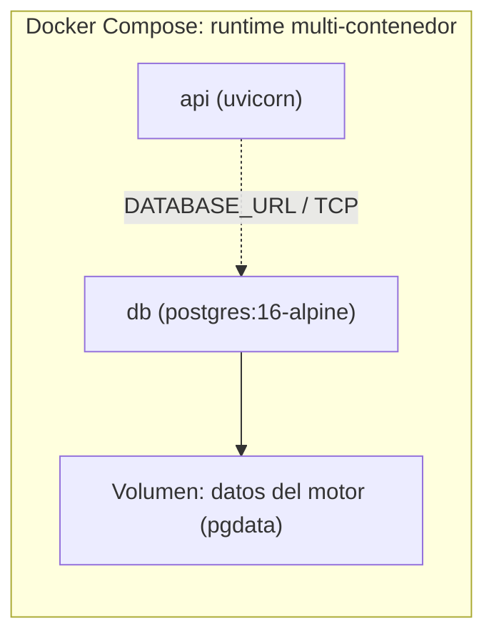

# ADR-004: Persistencia dual SQLite/PostgreSQL y runtime en contenedores

- **Estado**: Propuesto
- **Fecha**: 2026-11-22
- **Autor(es)**: Equipo IncidentOps
- **Reemplaza a**: ADR-001 (parcial: restringe la persistencia a SQLite3 embebido estándar y sin dependencias externas; este ADR añade persistencia dual con PostgreSQL y un runtime de contenedores)
---

## 1. Contexto y Problema

El almacenamiento actual es embebido: `src/adapters/outbound/sqlite_repository.py` usa `sqlite3` sin ORM, invocado por la fábrica `src/adapters/outbound/factory.py` (`create_incident_repository()`), cuyo default es `sqlite:///:memory:` y acepta rutas directas y URLs `sqlite:///...`. Según la constitución, cualquier cambio de motor exige ADR previo, y la arquitectura hexagonal (ADR-003) mantiene la regla: el núcleo no conoce ni quién lo invoca ni dónde se guardan los incidentes.

Los hitos H001–H002 ya consumen repositorios sin persistencia; H004 deja pendiente en el roadmap: arranque en contenedores con base de datos relacional dedicada. El estado actual no cumple ese objetivo: un único escritor a la vez, sin conectividad de red, sin réplicas, datos ligados al host/contenedor y sin volumen compartido.

Restricciones vigentes: mantener la dirección de dependencias de ADR-003 (puertos definidos por la aplicación, adaptador saliente seleccionado por la fábrica); mantener SQLite como uno de los motores admitidos para desarrollo (dual persistence); el runtime actual es `uvicorn` directo (AGENTS.md).

---

## 2. Opciones Consideradas

1. **Opción A — SQLite embebido (solo fichero, sin servidor ni contenedores)**:
   - *Ventajas*: sin operación de motor; ejecución en memoria (`sqlite:///:memory:`) para pruebas sin infraestructura; despliegue trivial (`uvicorn` directo); ideal para desarrollo y para el inicio del proyecto.
   - *Desventajas*: un único escritor a la vez y sin conectividad de red; datos ligados al host/contenedor sin volumen compartido; sin concurrencia real ni réplicas; no cumple H004 (no es base de datos relacional dedicada en contenedores).

2. **Opción B — PostgreSQL dedicado sin contenedores (servidor en el host)**:
   - *Ventajas*: concurrencia real y motor estándar de la industria; tooling consolidado para backups, tuning y recuperación; datos en un almacén dedicado.
   - *Desventajas*: operación del motor en el host (versiones, tuning, backups, upgrades); despliegue aún ligado a la máquina del host; no reproduce H004 ni desacopla runtime de motor; esquema de despliegue distinto al de arranque en contenedores.

3. **Opción C — PostgreSQL + runtime multi-contenedor con Docker Compose (`api` + `db` `postgres:16-alpine`)**:
   - *Ventajas*: H004 cumplida (arranque en contenedores con base de datos relacional dedicada); reproducible y aislado; concurrencia real entre instancias de `api`; escalabilidad a futuro de API y base; sin ORM.
   - *Desventajas*: dependencia de Docker en desarrollo y producción; configuración de compose (red, volumen, reinicios); operación del motor (backups, versionado de imágenes, tuning) asumida por el equipo.

---

## 3. Decisión Arquitectónica

Se elige la **Opción C**. Es difícil de revertir: volver a SQLite único implicaría migración de datos y nuevo ADR.

1. **H004 cumple**: reproduce arranque en contenedores con base de datos relacional dedicada; conectividad operativa `api`→`db` verificable.
2. **Motor PostgreSQL sin ORM**: driver estándar `psycopg[binary]`; control táctico de SQL (no ORM), coherente con la filosofía de sin dependencias y sin capas de persistencia adicionales (ADR-002, ADR-003).
3. **Paridad temporal sin ORM**: los campos `created_at`, `updated_at`, `resolved_at` se almacenan como `TEXT` con formato ISO 8601 en PostgreSQL, igual que almacena `sqlite3`; así ordenamiento lexicográfico y comparación de rangos coinciden entre motores.
4. **Selección vía `DATABASE_URL`**: la fábrica existente sigue siendo el único punto de selección del adaptador: URLs SQLite y rutas siguen a `SqliteIncidentRepository`; URLs PostgreSQL (`postgres://` / `postgresql://`) seleccionan el nuevo `PostgresIncidentRepository` implementando `IncidentRepositoryPort`; el default `sqlite:///:memory:` no cambia.
5. **Topología**: multired con contenedores `api` (uvicorn) y `db` (`postgres:16-alpine`) y volumen nombrado para los datos del motor; el directorio de datos del contenedor `db` se mapea a un volumen.

---

## 4. Consecuencias y Trade-offs

**Positivas:**
- H004: entorno reproducible de runtime y base de datos dedicada en contenedores; conectividad operativa verificable.
- Concurrencia real de múltiples instancias de `api` sobre PostgreSQL.
- Motor estándar de la industria con documentación y herramientas consolidadas.
- Aislamiento: datos en volumen; el runtime no depende de estado local de máquina.

**Negativas / Trade-offs:**
- Dependencia de Docker en desarrollo y producción (consecuencia aceptada).
- Curva de aprendizaje y configuración de compose (red, volumen, política de reinicios, health checks).
- Operación del motor asumida: backups, versionamiento de imágenes (`postgres:16-alpine`), tuning y monitorización.
- Costo táctico de SQL con más control de escritura y más deps en runtime (`psycopg[binary]`).
- Workflow de desarrollo cambia: ahora se requiere `docker compose up` antes de `uvicorn`.
